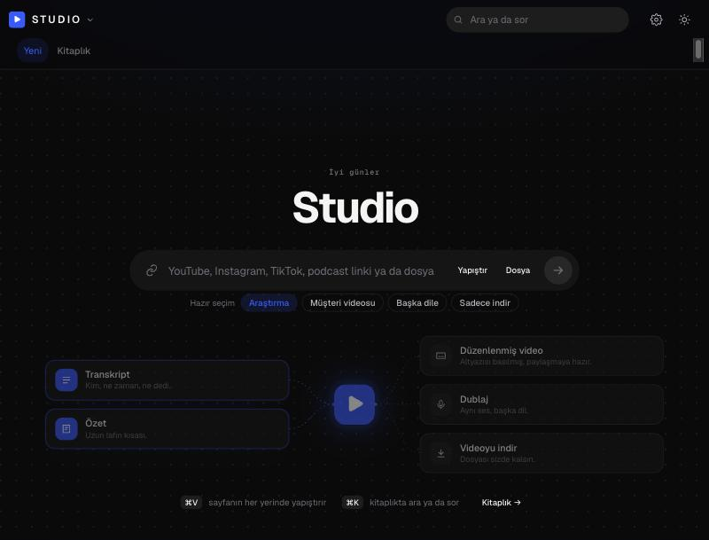

# Studio



Paste a video link or drop a file → transcript with speaker labels, summary, translation, subtitled video, clips and vertical Shorts,
dubbing in the speaker's own voice, and a publishing kit (titles, description, thumbnail text). Everything runs on your own Mac:
speech recognition on the Apple GPU (mlx-whisper), speaker separation on device (sherpa-onnx), writing with your own Claude
subscription (Claude Code sign-in) or, without it, a local Ollama model. No video or text leaves the computer.

Interface in English or Turkish (Settings → General → Language; follows the browser language on first launch).

## What it does

- **Transcribe:** YouTube, Instagram, TikTok, Vimeo and similar links, or local files; speaker separation and voice recognition;
  mixed languages; filtering of the lines Whisper hallucinates in silence; resume after interruption; Word, text and SRT output.
- **Summarize:** summary, highlights, timestamped chapters, decisions; ask questions about the video.
- **Translate and dub:** sentence-by-sentence translation (bilingual Word, translated SRT); dubbing in the speaker's own voice
  (Chatterbox on the Apple GPU).
- **Video:** subtitled video (box, plain, karaoke, pop and emphasis styles), clip cutting, face-tracked vertical framing (Shorts),
  text-based editing (click a paragraph → remove or reorder), silence removal, export to Final Cut / Premiere / DaVinci.
- **Publishing kit:** title options, description and chapters, tags, thumbnail text and thumbnail images, Shorts cuts, LinkedIn and
  Instagram copy; learns from what you like.
- **Library:** search in text and in the picture, channel watch (new videos are transcribed automatically), weekly digest.
- **Invite link:** share with a closed group (5 people, 3 videos a day) through a Cloudflare tunnel; guests only see their own records.
- **Self-improvement:** tracks tool versions and installs safe updates at night, weekly scan of what changed in the field,
  weekly self-review.

## Install (macOS, Apple silicon)

```bash
./kurulum.sh
.venv/bin/python site.py
```

Open http://127.0.0.1:8765. Or double-click `Studio.command`. The script installs `ffmpeg`, `deno` and `uv` with Homebrew, creates
`.venv` with the packages, and copies `ayarlar.ornek.json` → `ayarlar.json`. Optional: Ollama + `gemma3:4b` (local writing model when
Claude is not signed in), `cloudflared` (invite links). The Whisper model downloads on first use (~1.6 GB).

For writing with Claude, Claude Code only needs to be signed in on this Mac (`claude auth login`); without it everything falls back to
the local model.

## Personal data

The repository holds code and templates only. Your name, accounts, brand styles and all records live in files outside git
(`ayarlar.json`, `profil/`, `markalar/`, record and output folders). `python sizinti.py` scans the repo for personal data; a commit hook
and the restart gate enforce it.

## Development

`site.py` is a small loader; the code runs in `sunucu/00_… 24_….py` parts within one namespace. Tests: `.venv/bin/python -m pytest
tests -q` and `duman_testi.py hizli|birim|canli|studio`. After changing the server: `.venv/bin/python yeniden_baslat.py`. Architecture:
[docs/MIMARI.md](docs/MIMARI.md). Code identifiers and comments are in Turkish; the UI is bilingual. This repo is cut from a larger
workspace that develops sibling products (Meet, Ghost, Couple, Content, PT) on the same engine; siblings that are not installed are
simply off.

License: MIT.

---

**Türkçe:** Video linki ya da dosyası → transkript, özet, çeviri, altyazılı video, klip ve dikey Shorts, kendi sesiyle dublaj, yayın
paketi. Her şey kendi Mac'inizde çalışır; hiçbir video ya da metin dışarı gitmez. Kurulum: `./kurulum.sh` sonra `.venv/bin/python site.py`
ve tarayıcıda http://127.0.0.1:8765. Arayüz dili Ayarlar → Genel → Arayüz dili.
